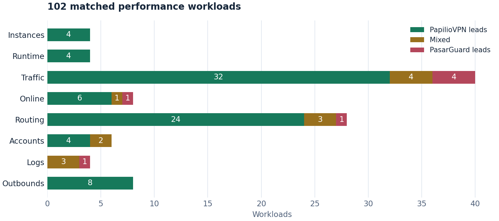

<p align="center">
  <picture>
    <source media="(prefers-color-scheme: dark)" srcset="assets/banner.png">
    
  </picture>
</p>

<h1 align="center">PapilioVPN Node</h1>

<p align="center" lang="en">The standalone Go service for Linux-host observations and engine management, starting with Xray.</p>

<p align="center">
  <strong lang="en"> English</strong> ·
  <a href="README.fa.md" lang="fa"> فارسی</a> ·
  <a href="README.ru.md" lang="ru"> Русский</a> ·
  <a href="README.zh-CN.md" lang="zh-CN"> 简体中文</a>
</p>

<p align="center">
  <a href="https://github.com/PapilioVPN/node/actions/workflows/check.yml"></a>
</p>

<p align="center">
  <a href="#quick-start">Quick start</a> ·
  <a href="#capabilities">Capabilities</a> ·
  <a href="#management">Management APIs</a> ·
  <a href="#benchmarks">Benchmarks</a> ·
  <a href="#development">Development</a>
</p>

## Quick start

Download the Linux amd64 archive and its checksum from [GitHub Releases](https://github.com/PapilioVPN/node/releases/latest). Verify and extract the archive, then run Node with the example settings.

```bash
archive=node-1.0.0-linux-amd64-YOUR_COMMIT_SHA.tar.gz
sha256sum -c "$archive.sha256" && tar -xzf "$archive"
cp -n node/config.example.yml config.yml
./node/node -config config.yml
```

To run the same build in Docker, load the bundled image and mount the settings file.

```bash
docker load -i node/image.tar
docker run --rm --network=host --read-only --cap-drop ALL \
  --mount "type=bind,source=$PWD/config.yml,target=/config.yml,readonly" \
  "$(cat node/image-name)"
```

<a name="current-capabilities"></a>

## Capabilities

| Area | Available operations |
| --- | --- |
| Node readiness | Check whether the Node management listeners are serving over HTTP and gRPC. |
| Host uptime | Read the elapsed time since Linux boot in whole seconds over HTTP and gRPC. |
| Host memory | Read total and available RAM, plus total and free swap, in bytes over HTTP and gRPC. |
| Host CPU | Read aggregate CPU utilization over HTTP and gRPC. |
| Host storage | Check space and read-only status for the filesystem backing a configured path. |
| Host system stats | Fetch uptime, CPU, memory and storage in one response. |
| Xray instance | Start, stop, and read state and versions over HTTP and gRPC. Start accepts typed initial accounts over both transports and supports keep-alive, compatible live configuration changes, and restart recovery. |
| Xray config validation | Check the configured Xray JSON over HTTP and gRPC before restarting the instance. |
| Xray runtime statistics | Read the active instance’s uptime, memory allocation, goroutines, and garbage collection counters over HTTP and gRPC. |
| Xray traffic resets | Read and clear one counter, both directions of a named account or tag, or a bounded scope over HTTP and gRPC when explicitly enabled. |
| Xray traffic counters | Read upload and download bytes for one or all accounts, inbound tags, or outbound tags over HTTP and gRPC. |
| Xray online accounts and IPs | List online accounts, count distinct source IPs, or read their last-seen times over HTTP and gRPC. |
| Xray routing | Read active rules, test a route, edit rules and inspect or override a balancer over HTTP and gRPC. |
| Xray accounts | Synchronize named accounts, full lists, or chunked deltas across selected inbounds over HTTP and gRPC, with confirmed membership restored on managed restart. Optional durable recovery also survives a Node restart. Sync skips inbounds listed in `exclude_inbounds` when the execution starts. Supports VLESS, VMess, Trojan, Shadowsocks, supported Shadowsocks 2022 servers, Hysteria, MASQUE, and Xray WireGuard. VLESS also supports direct add, remove, and count. |
| Xray log stream | Follow live stdout and stderr for the active Xray execution over HTTP and gRPC. |
| Xray outbound health | Read all recorded Observatory samples or select an outbound by tag over HTTP and gRPC. |

<a name="management"></a>

## Management APIs

HTTP `GET /v1/host/uptime` returns `uptime_seconds`. gRPC `HostService.GetUptime` returns the same quantity using the [Host API contract](internal/host/bridge/grpc/proto/v1/host.proto). Both read the boot clock visible to Node's Linux time namespace.

HTTP `GET /v1/host/memory` and gRPC `HostService.GetMemory` read the Linux `/proc/meminfo` visible to Node. Counts are in bytes. `available_bytes` is the kernel's estimate of RAM available without swapping and is present when the kernel reports it.

HTTP `GET /v1/host/cpu` and gRPC `HostService.GetCPU` serve one shared aggregate Linux CPU sample, updated about once per second. It includes `busy_percent`, `window_milliseconds`, `observed_at`, and `steal_percent` when Linux reports it. I/O wait and stolen time are excluded from busy time. While a valid interval is unavailable, HTTP returns `503` and gRPC returns `UNAVAILABLE`.

HTTP `GET /v1/host/storage` and gRPC `HostService.GetStorage` report `path`, `total_bytes`, `used_bytes`, `available_bytes`, and `read_only`. `available_bytes` excludes space reserved for privileged use. Set `host.storage_path` to an absolute path on the volume you want to monitor. The default is `/` in Node's mount namespace. In Docker, use the path visible inside the container. When the configured path cannot be inspected, HTTP returns `503` and gRPC returns `UNAVAILABLE`.

HTTP `GET /v1/host/stats` and gRPC `HostService.GetSystemStats` return `uptime_seconds`, `cpu`, `memory`, and `storage` using the individual operations' data and units. Unavailable fields are omitted, including `cpu` during its initial sample window.

Set `xray.id`, `xray.executable`, and `xray.config_file` in the [example configuration](deploy/config.example.yml) to enable one instance. Use Xray v26.11.9 and an operator-owned JSON file. At launch, Node replaces its `api` block with a private Unix socket for readiness. In Docker, mount the executable and JSON and provide a writable runtime directory, for example with `--tmpfs /tmp`. Remote Xray management requires TLS with an API key or client CA.

Use `GET /v1/xray/instances/{id}` for status and `PUT` or `DELETE /v1/xray/instances/{id}/execution` with an empty body to start or stop. The [gRPC contract](internal/engines/xray/instances/bridge/grpc/proto/v1/instances.proto) exposes `XrayInstancesService.Start`, `GetStatus`, and `Stop`. Start waits for the native API and Stop waits for the process to exit.

A startup failure returns HTTP `503` with a JSON `reason` or gRPC `UNAVAILABLE` with `XrayStartFailure` details. The reasons are `launch_failed`, `exited_before_ready`, `readiness_timeout`, and `readiness_failed`. The response includes `exit_code` when Xray supplied one after exiting before readiness.

Send an empty `POST /v1/xray/instances/{id}/config-validations` or call `XrayConfigsService.ValidateConfig` with the instance ID. Node tests the configured file with the same options used for startup. An invalid file returns `valid: false` and an issue code, with a line and column when Xray reports them. An execution failure returns an API error. [gRPC contract](internal/engines/xray/configs/bridge/grpc/proto/v1/configs.proto)

Use `GET /v1/xray/instances/{id}/stats/runtime` or `XrayStatsService.GetRuntimeStats`. Each response uses a fresh sample from the active Xray execution. Overlapping reads can share the next native sample. Memory fields report bytes, uptime counts whole seconds since the Xray stats service started, and cumulative GC pause is in nanoseconds. A configured instance that is unavailable returns HTTP `503` or gRPC `UNAVAILABLE`. The pending-read buffer holds 128 requests. When it is full, reads return HTTP `429` or gRPC `RESOURCE_EXHAUSTED`. [gRPC contract](internal/engines/xray/stats/bridge/grpc/proto/v1/runtime_stats.proto) · [Benchmark and raw results](benchmarks/xray/runtime/README.md#xray-runtime-statistics-after-the-rewrite)

Use `GET /v1/xray/instances/{id}/stats/traffic/{scope}` with `user`, `inbound`, or `outbound`. Add `?name=...` for one account or tag. The gRPC methods are `XrayStatsService.GetTraffic` and `ListTraffic`. Reads leave the counters intact. A missing direction is omitted and a stored zero is returned as zero. A missing named entry returns HTTP `404` or gRPC `NOT_FOUND`. List order is unspecified. Enable traffic statistics in the Xray policy for the selected scope. [gRPC contract](internal/engines/xray/stats/bridge/grpc/proto/v1/traffic.proto)

Enable `xray.reset_engine_stats: true` to allow traffic resets through the management API. Use `POST /v1/xray/instances/{id}/stats/traffic/{scope}/resets?name=...&direction=uplink` or `XrayStatsService.ResetTrafficCounter`. Use `downlink` to select the other direction. Xray atomically returns the previous byte count and clears the selected counter. An unknown outcome or a lost response requires reconciliation before a repeat.

Use `POST /v1/xray/instances/{id}/stats/traffic/{scope}/pair-resets?name=...` or `XrayStatsService.ResetTrafficPair` for both directions. Xray clears each direction separately. HTTP returns both outcomes in the response body, including when interrupted. gRPC includes partial progress in the status detail. Previous bytes are present only for acknowledged directions.

Use `POST /v1/xray/instances/{id}/stats/traffic/{scope}/scope-resets?max_counters=...` or `XrayStatsService.ResetTrafficScope` for a whole scope. Set the limit from 1 to 1000 directional counters. If the selection exceeds the limit, it is rejected before any reset. Check the response outcome and the result of each counter. gRPC returns an interrupted or unknown report in the response body. Scoped resets run sequentially by default. Set `xray.reset_scope_concurrency` to 2–8 to allow parallel native resets. [Contract and benchmarks](benchmarks/xray/traffic/scope-reset.md)

For a one-call reset, use the packaged `/node-xray` executable and set `xray.native_scope_reset: true`. The standard Xray executable uses the sequential or configured parallel path.

Use `GET /v1/xray/instances/{id}/stats/online/count?name=...` or `/stats/online/ips?name=...` under the same instance path. The gRPC methods are `XrayStatsService.GetOnlineIPCount` and `ListOnlineIPs`. Enable `statsUserOnline` at the account's policy level. Timestamps are Unix seconds. An account with an empty tracked IP map returns zero or an empty map. A missing observation returns HTTP `404` or gRPC `NOT_FOUND`. [gRPC contract](internal/engines/xray/stats/bridge/grpc/proto/v1/online.proto)

Use `GET /v1/xray/instances/{id}/stats/online/users` or `XrayStatsService.ListOnlineUsers` to list account names with at least one source IP currently tracked by Xray. The list has no guaranteed order. When there are no online accounts, HTTP returns `{"names":[]}`.

Use `GET /v1/xray/instances/{id}/routing/rules` and `GET /v1/xray/instances/{id}/routing/balancer?tag=...` to read routing state. The gRPC methods are `XrayRoutingService.ListRoutingRules` and `GetBalancerInfo`. The response reports the override separately from the targets reported by Xray. [gRPC contract](internal/engines/xray/routing/bridge/grpc/proto/v1/routing.proto)

Use `XrayRoutingService.TestRoute`, `AddRoutingRule`, `RemoveRoutingRule` and `OverrideBalancerTarget` to evaluate and modify the live router. The HTTP routes and confirmation for rule replacement are documented with the benchmark. [Routing control](benchmarks/xray/routing/rule-writes.md)

Use `XrayAccountsService.AddVLESSAccount`, `RemoveVLESSAccount` and `CountVLESSAccounts` or the HTTP routes under `/v1/xray/instances/{id}/inbounds/{tag}/accounts`. These operations apply to the active execution. [VLESS contract](benchmarks/xray/accounts/vless.md)

[VLESS synchronization](benchmarks/xray/accounts/sync.md) · [Xray log stream](benchmarks/xray/logs/contract.md)

To retain confirmed synchronization after a Node restart, set `xray.state_directory` to an existing directory owned by the Node user with mode `0700`. Mount it as writable persistent storage when running in Docker. Node writes the private account state before acknowledging synchronization and restores it before the next `Start` reports ready. Keep the configured instance ID and its compatible inbounds when restarting.

Use `GET /v1/xray/instances/{id}/outbounds/health` or `XrayOutboundsService.GetOutboundHealth` to read ordinary Observatory samples. Provide a tag for one outbound. The response distinguishes healthy, failed and missing samples. [gRPC contract](internal/engines/xray/outbounds/bridge/grpc/proto/v1/outbounds.proto)

The example binds both listeners to loopback. HTTP `GET /healthz` returns `204 No Content` when ready. The gRPC health service on port 8081 reports `SERVING` for the empty service name. Set `management.tls.cert_file` and `management.tls.key_file` to enable TLS. Optionally configure `management.tls.client_ca_file` for mutual TLS and `management.api_key` for the `x-api-key` header or metadata.

## Benchmarks

<!-- benchmark-summary -->
**PapilioVPN led in 82 of 102 matched Xray workloads** against PasarGuard 0.5.7. Results were mixed in 13 workloads, and PasarGuard led in 7. The dashboard also covers 16 shared-fixture workloads with different inputs, output fields, or guarantees.
<!-- /benchmark-summary -->



[Benchmark dashboard, group reports, and raw data](benchmarks/xray/README.md)

## Development

See the [contribution guide](CONTRIBUTING.md) for opening a pull request and verifying a change.

Run the checks with Go 1.27.4 or newer. The packaging command also requires Docker and curl.

```bash
bash scripts/ci/check.sh
bash scripts/ci/package.sh
```

After editing `host.proto`, regenerate `host.pb.go` in the same directory. Use `protoc` 36.2 and `protoc-gen-go` v1.36.12 on `PATH`, then run this command from the repository root.

```bash
go generate ./internal/host/bridge/grpc
```

To regenerate the Xray schemas, also install `protoc-gen-go-grpc` v1.6.0 and run `go generate ./internal/engines/xray/...`. Set `NODE_TEST_XRAY` to the absolute path of Xray v26.11.9 to run the native integration tests locally.
