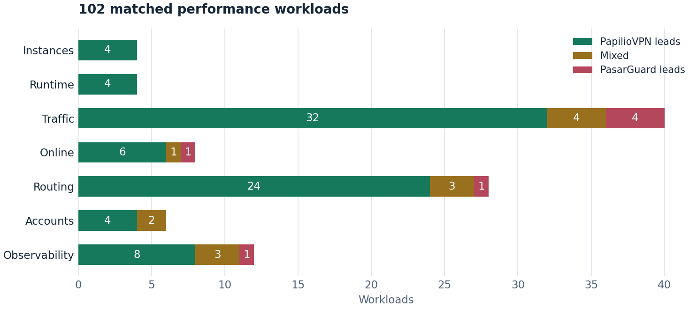
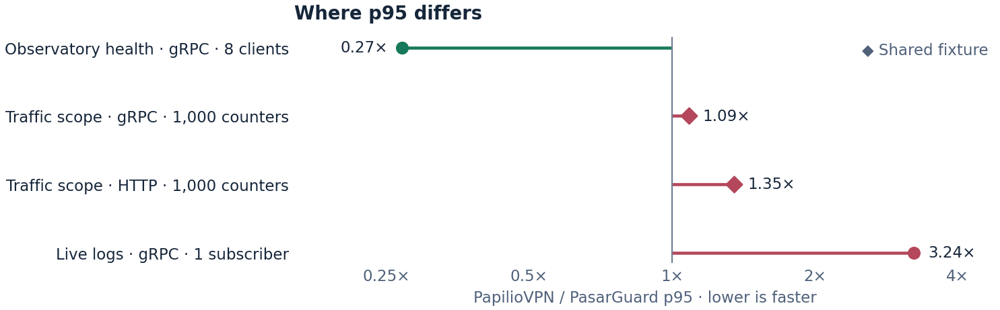

# Benchmarks

**PapilioVPN led in 82 of 102 matched workloads** against PasarGuard 0.5.7 (`739eab9`). Across 122 published comparisons, 20 use a shared fixture with different public guarantees or response fields.



| Report | PapilioVPN leads | Mixed | PasarGuard leads | Shared fixture cases |
| --- | ---: | ---: | ---: | ---: |
| [Host](reports/host.md) | 0 | 0 | 0 | 4 |
| [Instances](reports/instances.md) | 4 | 0 | 0 | 2 |
| [Runtime](reports/runtime.md) | 4 | 0 | 0 | 0 |
| [Traffic](reports/traffic.md) | 32 | 4 | 4 | 14 |
| [Online](reports/online.md) | 6 | 1 | 1 | 0 |
| [Routing](reports/routing.md) | 24 | 3 | 1 | 0 |
| [Accounts](reports/accounts.md) | 4 | 2 | 0 | 0 |
| [Observability](reports/observability.md) | 8 | 3 | 1 | 0 |
| **Total** | **82** | **13** | **7** | **20** |

Shared fixture results are 14 PapilioVPN leads, 3 mixed and 3 PasarGuard leads. Host system stats has different fields and sampling behavior. Start uses a local config file for Node and sends the JSON in the request for PasarGuard. Traffic reset compares the same counters on unambiguous fixtures, with different selection and failure guarantees.



## Reading the results

- Each case is one operation, transport and workload. The scorecard records the specific CSV, phase and number of paired rounds for every case. A phase retained in the running code replaces an earlier measurement of the same workload where a selected repeat exists.
- A lead requires lower median round p50 and p95 and, for windowed request tests, higher successful requests per second. Mixed covers split results and ties. No minimum margin or statistical confidence is inferred. Log comparisons score fresh delivery latency at a fixed producer rate.
- Native-only diagnostics, traffic lists with extra management counters, and full/chunked sync with different restart or stream completion behavior are available in the group reports.
- Published comparisons span several Node revisions and pinned fixtures. The linked reports give the exact environment and reproduction commands.

[Scorecard CSV](scorecard.csv) · [Raw Xray results](xray/results/) · [Raw host results](host/results/)

<a name="reproduce"></a><a name="xray-instance-lifecycle"></a>

[Runner setup and lifecycle reproduction](reports/instances.md#reproduce)

<a name="xray-runtime-statistics-after-the-rewrite"></a>

[Runtime statistics and per-round data](reports/runtime.md#xray-runtime-statistics-after-the-rewrite)

Regenerate the scorecard, charts, and README summaries from the repository root with Python 3 and Matplotlib.

```sh
python3 benchmarks/summarize.py
```
